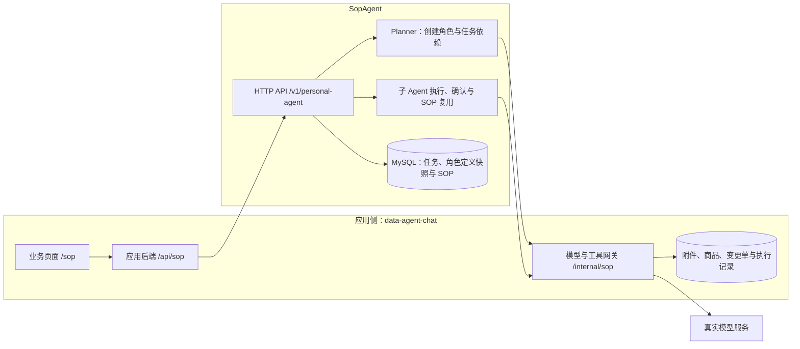
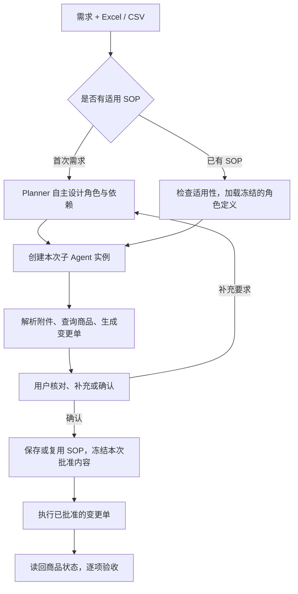

# SopAgent

SopAgent 为业务应用提供通用的 Agent 与 SOP 编排服务。应用提交需求和上下文后，Planner 根据可用工具自主创建子 Agent 的职责、指令、工具范围和任务依赖；用户确认方案后，服务保存可复用的 SOP 并执行后续步骤。

当前 Demo 接入 `data-agent-chat`：用户在 `/sop` 页面提交商品上下架需求与 Excel / CSV，查看动态团队、确认变更单，并在下一次任务中复用 SOP。

## 架构与职责



| 组件 | 负责的内容 |
| --- | --- |
| SopAgent | Planner、动态角色定义、独立子 Agent 上下文、任务依赖、状态与产物、用户确认、SOP 保存和复用 |
| 应用后端 | 用户身份与项目权限、附件、业务表、业务规则、模型调用、业务工具与执行验收 |
| 应用前端 | 需求输入、上传文件、展示团队与进度、查看变更单、补充要求、确认和选择 SOP |

**当前模型调用由应用侧网关完成。** SopAgent 将 Planner 或子 Agent 的模型请求发送到 `/internal/sop/model`，由 `data-agent-chat` 后端调用配置的模型。本次 Demo 使用 `qwen4-max`，商品查询与上下架操作使用本地模拟后台。

SopAgent 的任务与 SOP 保存在 MySQL；Demo 的业务数据保存在应用侧的 `backend/data/sop-demo.db`。新增业务能力时，在应用侧提供工具和数据，并通过网关暴露给 SopAgent。

## 应用如何接入

应用需要完成两个方向的 HTTP 对接：

1. **应用后端调用 SopAgent**：创建任务、查询进度、提交补充信息、确认方案、读取 SOP。
2. **SopAgent 调用应用网关**：读取工具目录、调用模型、执行工具。

### 1. 配置并启动两端

准备 `go.mod` 指定版本的 Go、可用的 MySQL，以及已配置模型的应用后端。在 SopAgent 仓库根目录创建 `local.env`，填写本机配置：

```dotenv
AGENTFLOW_MYSQL_DSN='user:password@tcp(127.0.0.1:3306)/sopagent'
SOP_AGENT_ADDR='127.0.0.1:8091'
SOP_AGENT_SERVICE_TOKEN='<应用后端调用 SopAgent 的随机令牌>'
SOP_AGENT_GATEWAY_URL='http://127.0.0.1:3009/internal/sop'
SOP_AGENT_GATEWAY_TOKEN='<SopAgent 调用应用网关的另一个随机令牌>'
```

`local.env` 已被 Git 忽略。SopAgent 默认读取当前目录的该文件，已导出的环境变量优先。该文件只配置通用服务自身的数据库、监听地址和网关连接，不存放模型配置。

在 SopAgent 根目录启动通用服务：

```bash
go run ./cmd/personal-agent
```

可通过 `-env-file /path/to/local.env` 指定配置文件，或通过 `-addr` 覆盖监听地址。`GET http://127.0.0.1:8091/health` 用于检查服务状态。

在 `data-agent-chat/backend/.env` 中单独配置应用侧的服务连接、Demo 身份和模型：

```dotenv
SOP_AGENT_SERVICE_URL='http://127.0.0.1:8091'
SOP_AGENT_SERVICE_TOKEN='<与 SopAgent local.env 中的服务令牌一致>'
SOP_AGENT_GATEWAY_TOKEN='<与 SopAgent local.env 中的网关令牌一致>'

# Demo 的本机用户与项目范围；实际应用应使用已登录用户的身份。
SOP_AGENT_PROJECT_ID='listing-demo'
SOP_AGENT_ACTOR_ID='local-demo-user'

# 模型配置仅由应用侧网关使用。
OPENAI_BASE_URL='https://your-model-gateway.example/v1'
OPENAI_API_KEY='<模型 API Key>'
MODEL_NAME='<模型名称>'
```

两端独立维护配置文件，只需让同名的服务令牌、网关令牌分别对应；应用后端不读取 SopAgent 的 `local.env`。修改模型时，更新 `data-agent-chat/backend/.env` 并重启应用后端。

另开终端，在 `data-agent-chat/backend` 中启动 Demo 应用后端：

```bash
uv run --env-file .env python -m uvicorn app.main:app --host 127.0.0.1 --port 3009
```

首次运行应用时，按 `data-agent-chat` 的说明安装依赖，并在其 `web` 目录执行 `npm run build`。随后打开 [Demo 入口](http://127.0.0.1:3009/sop)。

当前服务使用单实例后台执行：同一数据库只运行一个 SopAgent 实例。重启后，中断任务会标记为失败，未完成的写调用标记为结果未知，需核对业务结果后再处理。新表基线见 [迁移脚本](migrations/034_personal_agent.sql)，由运维手动执行；服务连接数据库时沿用增量 DDL 补齐缺失表、列和索引。

### 2. 调用任务与 SOP API

应用后端调用以下接口时，提供服务令牌以及由后端确认的项目和用户身份：

```http
Authorization: Bearer <SOP_AGENT_SERVICE_TOKEN>
X-Project-ID: <project-id>
X-Actor-ID: <actor-id>
Content-Type: application/json
```

浏览器通过应用后端访问这些能力；令牌保留在服务端。Demo 使用配置中的固定用户与项目，接入实际用户系统时，应由应用后端验证登录身份及项目权限。

| 方法 | 路径（前缀为 `/v1/personal-agent`） | 用途 |
| --- | --- | --- |
| `GET` | `/capabilities` | 查看当前项目可用工具 |
| `POST` | `/tasks` | 创建任务，返回 `202` 和任务对象 |
| `GET` | `/tasks` | 查询当前用户与项目的任务 |
| `GET` | `/tasks/{id}` | 查询角色、运行状态、工具回执和产物 |
| `POST` | `/tasks/{id}/feedback` | 对待确认或尚未批准的失败任务补充要求并重新规划 |
| `POST` | `/tasks/{id}/confirm` | 批准当前方案，保存或复用 SOP，进入执行阶段 |
| `GET` | `/sops` | 查询可复用 SOP |

创建任务时，附件由应用保存，SopAgent 接收文件引用等上下文：

```http
POST /v1/personal-agent/tasks

{
  "request": "按附件立即处理商品上下架，先给我确认方案，再执行并读回",
  "context": {"attachmentId": "<应用保存的附件 ID>"}
}
```

创建后轮询任务详情。主要状态为：

```text
planning → analyzing → awaiting_confirmation → executing → succeeded
任一运行阶段发生错误 → failed
```

分析完成后，页面展示实际工具返回的变更单。存在真正阻塞执行的未决问题时，提交补充信息：

```json
{"revision": 12, "message": "仅处理附件列出的商品，立即生效，其余保持现状"}
```

提交到 `/tasks/{id}/feedback` 后会重新规划并分析。用户确认时，把当前任务响应中的 `revision` 和 `planHash` 原样发送到 `/tasks/{id}/confirm`：

```json
{"revision": 20, "planHash": "<当前任务的 planHash>"}
```

确认绑定计划、分析结果和工具证据；版本过期返回 `409`，需要刷新并重新核对。首次确认时，SOP 与批准记录原子保存；后续任务显式复用时，在创建请求中传入 `sopId`：

```json
{
  "request": "沿用此 SOP，处理这次新附件中的商品",
  "context": {"attachmentId": "<新附件 ID>"},
  "sopId": "<已保存的 SOP ID>"
}
```

服务会检查 SOP 适用性，加载其中冻结的角色定义，为新任务创建执行实例。新清单会重新查询、预检和确认。未指定 `sopId` 时，Planner 也可从已有 SOP 中选择适用项。

### 3. 提供模型与业务工具网关

SopAgent 只调用服务端配置的网关地址。应用网关验证 `SOP_AGENT_GATEWAY_TOKEN`，并按 `X-Project-ID`、`X-Actor-ID` 校验数据范围。

| 网关接口 | 接收与返回 |
| --- | --- |
| `GET /capabilities` | 返回 `{"tools":[...]}`，声明工具名称、说明、输入 schema、读写类型与必需执行阶段 |
| `POST /model` | 接收 `purpose`、`system`、`messages`；返回 `{"content":"模型响应文本"}` |
| `POST /tools/{name}` | 接收 `taskId`、`callId`、`arguments` 和执行阶段的 `approval`；返回 `{"result":...}` |

例如，工具声明可包含：

```json
{
  "name": "execute_listing_changes",
  "description": "执行本任务已批准的不可变变更单",
  "effect": "write",
  "requiredPhase": "execution",
  "inputSchema": {
    "type": "object",
    "properties": {"planId": {"type": "string"}},
    "required": ["planId"]
  }
}
```

`effect` 为 `read` 或 `write`，分析阶段仅允许读工具。`requiredPhase` 可省略，或设为 `analysis` / `execution`；声明后，该阶段正常完成必须有对应工具的成功回执。分析存在未决问题时可以先暂停等待用户补充；这些问题会阻止确认，补充后需重新分析。

应用的写工具还需验证具体变更单、批准记录、权限、数据版本和幂等状态。执行请求中的 `approval.revision` 对应任务的 `approvedRevision`；任务进度的 `revision` 会继续递增。验收不通过时，工具应返回错误。

完整请求格式见 [接入协议](docs/personal-agent.md)。

## Demo：首次形成 SOP，再次复用



本次真实模型演示由 Planner 自主生成了 3 个角色：**范围核对与变更预览、变更单执行、逐项读回验收**。角色名称、职责、指令和依赖由模型根据需求生成；SOP 保存完整定义，后续复用时创建新实例。

| Demo 工具（由 `data-agent-chat` 提供） | 职责 |
| --- | --- |
| `read_attachment` | 读取文件内容与原始行号 |
| `query_products` | 查询 SKU、渠道、区域、当前状态及版本 |
| `preview_listing_changes` | 保存不可变变更单，返回旧值、新值和 `planId`；分析阶段必需 |
| `execute_listing_changes` | 校验批准与版本，幂等执行该 `planId`；执行阶段必需 |
| `verify_listing_changes` | 读回并逐项对账；执行阶段必需 |

### 在页面中操作

1. 打开 `/sop`，点击“准备演示数据”，下载示例清单或上传自己的演示 CSV / XLSX。XLSX 首版读取活动工作表，文件最多 5 MB、200 行。
2. 提交明确的操作范围。Planner 创建团队，分析角色调用应用工具生成可核对的变更单。
3. 查看商品、渠道、区域及修改前后状态；需要调整时补充说明并重新规划，确认后保存 SOP 并执行。
4. 查看执行与读回结果。在 SOP 列表中点击“用于新任务”，上传另一份清单，再次核对、确认和执行。

已录制的验证场景中，首次处理华南 2 项商品变更，第二次使用同一 SOP 处理华东 1 项新变更；两次均完成真实模型调用、用户确认、模拟后台执行和读回验收。

本机演示视频生成在 `.local/demo/sop-agent-real-model.mp4`，验证摘要在 `.local/demo/verification.json`；这些本地产物与 `local.env` 一同被 Git 忽略。

---

基于 [LoopForge](https://github.com/Tencent/LoopForge) 改造，保留其 [MIT 许可](LICENSE)。
