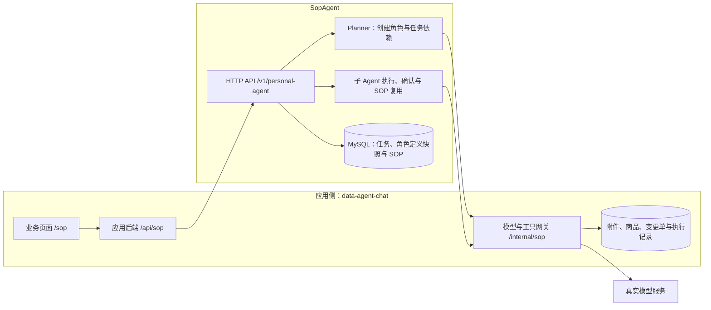
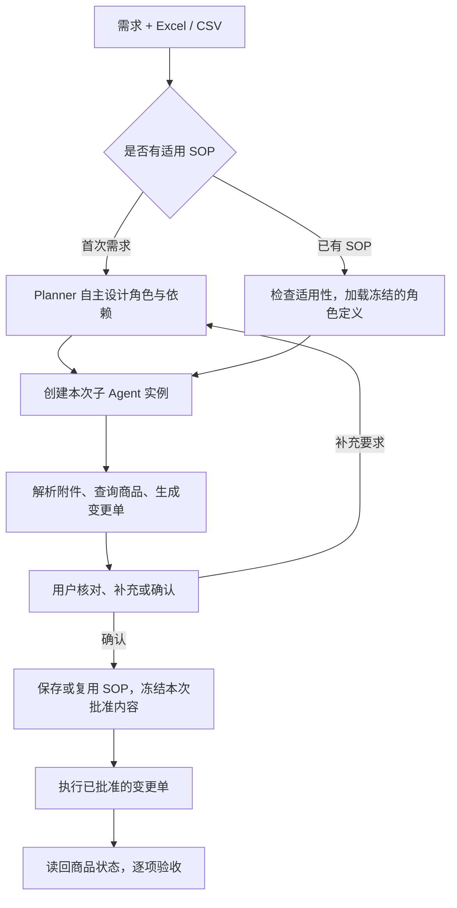

# SopAgent

SopAgent 为业务应用提供通用的 Agent 与 SOP 编排服务。应用提交需求和上下文后，Planner 根据可用工具自主创建子 Agent 的职责、指令、工具范围和任务依赖；用户确认方案后，服务保存可复用的 SOP 并执行后续步骤。

当前 Demo 接入 `data-agent-chat`：用户在 `/sop` 页面提交商品上下架需求与 Excel / CSV，查看动态团队、确认变更单，并在下一次任务中复用 SOP。

## 架构与职责



| 组件 | 负责的内容 |
| --- | --- |
| SopAgent | Planner、动态角色定义、独立子 Agent 上下文、任务依赖、状态与产物、用户确认、SOP 保存和复用 |
| 应用后端 | 用户身份与项目权限、附件、业务表、业务规则、模型调用、业务工具与执行验收 |
| 应用前端 | 需求输入、上传文件、展示团队与进度、查看变更单、补充要求、确认和选择 SOP |

**当前模型调用由应用侧网关完成。** SopAgent 将 Planner 或子 Agent 的模型请求发送到 `/internal/sop/model`，由 `data-agent-chat` 后端调用配置的模型。本次 Demo 使用 `qwen4-max`，商品查询与上下架操作使用本地模拟后台。

SopAgent 的任务与 SOP 保存在 MySQL；Demo 的业务数据保存在应用侧的 `backend/data/sop-demo.db`。新增业务能力时，在应用侧提供工具和数据，并通过网关暴露给 SopAgent。

## 应用如何接入

应用需要完成两个方向的 HTTP 对接：

1. **应用后端调用 SopAgent**：创建任务、查询进度、提交补充信息、确认方案、读取 SOP。
2. **SopAgent 调用应用网关**：读取工具目录、调用模型、执行工具。

### 1. 配置并启动两端

准备 `go.mod` 指定版本的 Go、可用的 MySQL，以及已配置模型的应用后端。在 SopAgent 仓库根目录创建 `local.env`，填写本机配置：

```dotenv
AGENTFLOW_MYSQL_DSN='user:password@tcp(127.0.0.1:3306)/sopagent'
SOP_AGENT_ADDR='127.0.0.1:8091'
SOP_AGENT_SERVICE_TOKEN='<应用后端调用 SopAgent 的随机令牌>'
SOP_AGENT_GATEWAY_URL='http://127.0.0.1:3009/internal/sop'
SOP_AGENT_GATEWAY_TOKEN='<SopAgent 调用应用网关的另一个随机令牌>'
```

`local.env` 已被 Git 忽略。SopAgent 默认读取当前目录的该文件，已导出的环境变量优先。该文件只配置通用服务自身的数据库、监听地址和网关连接，不存放模型配置。

在 SopAgent 根目录启动通用服务：

```bash
go run ./cmd/personal-agent
```

可通过 `-env-file /path/to/local.env` 指定配置文件，或通过 `-addr` 覆盖监听地址。`GET http://127.0.0.1:8091/health` 用于检查服务状态。

在 `data-agent-chat/backend/.env` 中单独配置应用侧的服务连接、Demo 身份和模型：

```dotenv
SOP_AGENT_SERVICE_URL='http://127.0.0.1:8091'
SOP_AGENT_SERVICE_TOKEN='<与 SopAgent local.env 中的服务令牌一致>'
SOP_AGENT_GATEWAY_TOKEN='<与 SopAgent local.env 中的网关令牌一致>'

# Demo 的本机用户与项目范围；实际应用应使用已登录用户的身份。
SOP_AGENT_PROJECT_ID='listing-demo'
SOP_AGENT_ACTOR_ID='local-demo-user'

# 模型配置仅由应用侧网关使用。
OPENAI_BASE_URL='https://your-model-gateway.example/v1'
OPENAI_API_KEY='<模型 API Key>'
MODEL_NAME='<模型名称>'
```

两端独立维护配置文件，只需让同名的服务令牌、网关令牌分别对应；应用后端不读取 SopAgent 的 `local.env`。修改模型时，更新 `data-agent-chat/backend/.env` 并重启应用后端。

另开终端，在 `data-agent-chat/backend` 中启动 Demo 应用后端：

```bash
uv run --env-file .env python -m uvicorn app.main:app --host 127.0.0.1 --port 3009
```

首次运行应用时，按 `data-agent-chat` 的说明安装依赖，并在其 `web` 目录执行 `npm run build`。随后打开 [Demo 入口](http://127.0.0.1:3009/sop)。

当前服务使用单实例后台执行：同一数据库只运行一个 SopAgent 实例。重启后，中断任务会标记为失败，未完成的写调用标记为结果未知，需核对业务结果后再处理。新表基线见 [迁移脚本](migrations/034_personal_agent.sql)，由运维手动执行；服务连接数据库时沿用增量 DDL 补齐缺失表、列和索引。

### 2. SopAgent 提供什么，应用在什么时候调用

**以下接口由 SopAgent 实现，应用后端调用。** Demo 中的服务地址是 `http://127.0.0.1:8091`，统一前缀是 `/v1/personal-agent`。

| 应用中的场景 | 应用后端调用 SopAgent | 得到什么 |
| --- | --- | --- |
| 用户提交一条新需求 | `POST /tasks` | 新任务，包含任务 `id` |
| 页面展示团队、进度和结果 | `GET /tasks/{id}` | 当前状态、角色定义、执行结果与工具回执 |
| 用户补充或修改要求 | `POST /tasks/{id}/feedback` | 更新后的任务，重新规划和分析 |
| 用户点击“确认方案并执行” | `POST /tasks/{id}/confirm` | 保存或复用 SOP，并开始执行的任务 |
| 打开历史任务列表 | `GET /tasks` | `{"tasks":[...]}` |
| 打开可复用 SOP 列表 | `GET /sops` | `{"sops":[...]}` |
| 查看当前可用工具 | `GET /capabilities` | `{"tools":[...]}` |

每次请求携带下列请求头。项目和用户身份由应用后端确认，令牌保留在服务端：

```http
Authorization: Bearer <SOP_AGENT_SERVICE_TOKEN>
X-Project-ID: <project-id>
X-Actor-ID: <actor-id>
Content-Type: application/json
```

**一次首次任务，应用只需按下面的顺序调用：**

1. **创建任务。** 文件先上传并保存在应用侧，再把需求和文件引用传给 SopAgent：

   ```http
   POST http://127.0.0.1:8091/v1/personal-agent/tasks

   {
     "request": "按附件处理商品上下架，先给我确认，再执行并读回",
     "context": {"attachmentId": "file-001"}
   }
   ```

   返回 `202` 和任务对象，例如 `{"id":"task-001","status":"planning","revision":1,...}`。应用保存这个 `id`，用于后续查询和确认。角色由 Planner 自主创建。

2. **查询进度。** 轮询 `GET /tasks/task-001`，直到 `status` 为 `awaiting_confirmation`，再展示团队与实际变更清单让用户核对；若状态为 `failed`，展示错误原因。

   | 任务响应字段 | 页面如何使用 |
   | --- | --- |
   | `plan.agents` | 展示本次创建的角色、职责和依赖 |
   | `runs` | 按 `agentId` 对应角色，展示执行状态和结果 |
   | `runs[].toolCalls` | 展示工具回执；Demo 的商品变更清单来自成功预检工具返回的 `result.items` |
   | `revision`、`planHash` | 用户确认时原样回传，绑定本次看到的方案 |

3. **按用户选择补充或确认。** 两个接口的 `{id}` 都是当前任务 ID，请求中的值取自最新任务响应：

   | 用户操作 | 应用调用 | 请求体 |
   | --- | --- | --- |
   | 补充要求 | `POST /tasks/{id}/feedback` | `{"revision":12,"message":"仅处理附件列出的商品"}` |
   | 批准执行 | `POST /tasks/{id}/confirm` | `{"revision":12,"planHash":"<当前任务的 planHash>"}` |

   补充后重新查询任务并核对方案。补充入口适用于待确认或尚未批准的失败任务；未决问题会阻止确认，版本过期返回 `409`。

   **确认接口会同时保存 SOP、记录批准并开始执行，应用无需再调用“创建角色”“保存 SOP”或“启动执行”接口。** SOP 在确认时保存，业务执行结果通过后续查询获取。

4. **查询执行结果。** 继续轮询任务详情，直到 `succeeded` 或 `failed`。确认后的任务中，`sopId` 是本次保存或复用的 SOP ID。

**下一次同类需求：仍然创建新任务，额外传入 `sopId` 即可。**

```http
POST http://127.0.0.1:8091/v1/personal-agent/tasks

{
  "request": "沿用此 SOP，处理这次新附件中的商品",
  "context": {"attachmentId": "file-002"},
  "sopId": "<上次任务的 sopId，或 SOP 列表中的 id>"
}
```

之后沿用上面的查询、确认和查看结果步骤。SopAgent 加载已保存的角色定义，创建新的执行实例，并针对本次输入重新查询、预检和确认。未指定 `sopId` 时，Planner 也可以选择已有的适用 SOP。

> Demo 前端调用的 `/api/sop/*` 是 **data-agent-chat 自己的代理接口**，再由它调用上述 SopAgent 接口。例如，应用代理接收 `attachmentId`，转成 `context.attachmentId` 后传给 SopAgent；两者的请求体不完全相同。

### 3. 应用需要提供什么，SopAgent 在什么时候调用

**以下 3 个接口由应用后端实现，SopAgent 调用。** Demo 的完整地址如下；SopAgent 根据配置的 `SOP_AGENT_GATEWAY_URL` 拼接 `/capabilities`、`/model`、`/tools/{name}`。

| 应用需要实现的接口 | SopAgent 何时调用 | 应用需要做什么 | 返回格式 |
| --- | --- | --- | --- |
| `GET http://127.0.0.1:3009/internal/sop/capabilities` | 规划或执行任务时 | 列出当前用户可用的业务工具及参数格式 | `{"tools":[...]}` |
| `POST http://127.0.0.1:3009/internal/sop/model` | Planner 思考、子 Agent 分析或决定下一步时 | 用应用自己的模型配置调用 LLM | `{"content":"<模型响应文本>"}` |
| `POST http://127.0.0.1:3009/internal/sop/tools/{name}` | 子 Agent 需要读取数据或执行操作时 | 按工具名调用对应业务函数，返回真实结果 | `{"result":...}` |

两边都有 `/capabilities`：应用侧接口定义工具目录，SopAgent 侧接口供应用查询当前可用工具。

调用这些接口时，SopAgent 会携带 `Authorization: Bearer <SOP_AGENT_GATEWAY_TOKEN>` 以及 `X-Project-ID`、`X-Actor-ID`。应用后端负责验证令牌和用户的数据权限。

**工具目录：告诉 Planner 有哪些能力可用。** 例如，`GET /internal/sop/capabilities` 返回：

```json
{
  "tools": [{
    "name": "query_products",
    "description": "按 SKU 查询商品和当前上下架状态",
    "effect": "read",
    "inputSchema": {
      "type": "object",
      "properties": {"sku": {"type": "string"}}
    }
  }]
}
```

**模型接口：应用只负责转发模型请求。** SopAgent 发来的请求形如：

```json
{
  "purpose": "planner",
  "system": "SopAgent 生成的系统指令，包含要求的 JSON 输出格式",
  "messages": [{"role":"user","content":"本次任务输入"}]
}
```

应用将指令和消息传给自己的模型，返回 `{"content":"<模型按要求生成的 JSON 文本>"}`。角色规划、工具选择和任务状态由 SopAgent 管理。

**工具接口：应用执行真实业务逻辑。** 例如，SopAgent 调用 `POST /internal/sop/tools/query_products`：

```json
{
  "taskId": "task-001",
  "callId": "call-001",
  "arguments": {"sku":"DEMO-WINE-001"}
}
```

应用执行商品查询，返回 `{"result":{"products":[...]}}`。执行阶段还会携带 `approval`，写工具必须核验具体变更单、批准记录、数据版本和幂等状态后再实施。

工具的 `effect` 为 `read` 或 `write`，确认前只允许读工具。应用可以用 `requiredPhase: "analysis"` 或 `"execution"` 声明必需工具；阶段完成要有真实成功回执。Demo 要求确认前有预检回执，确认后有执行与读回验收回执。

Demo 的这 3 个应用接口实现在 `data-agent-chat/backend/app/sop.py`，并在该项目的 `backend/app/main.py` 注册。`/internal/sop/model` 由路由前缀 `/internal/sop` 与处理函数上的 `/model` 拼接而成。

更多字段、错误处理与批准校验见 [接入协议](docs/personal-agent.md)。

## Demo：首次形成 SOP，再次复用



本次真实模型演示由 Planner 自主生成了 3 个角色：**范围核对与变更预览、变更单执行、逐项读回验收**。角色名称、职责、指令和依赖由模型根据需求生成；SOP 保存完整定义，后续复用时创建新实例。

| Demo 工具（由 `data-agent-chat` 提供） | 职责 |
| --- | --- |
| `read_attachment` | 读取文件内容与原始行号 |
| `query_products` | 查询 SKU、渠道、区域、当前状态及版本 |
| `preview_listing_changes` | 保存不可变变更单，返回旧值、新值和 `planId`；分析阶段必需 |
| `execute_listing_changes` | 校验批准与版本，幂等执行该 `planId`；执行阶段必需 |
| `verify_listing_changes` | 读回并逐项对账；执行阶段必需 |

### 在页面中操作

1. 打开 `/sop`，点击“准备演示数据”，下载示例清单或上传自己的演示 CSV / XLSX。XLSX 首版读取活动工作表，文件最多 5 MB、200 行。
2. 提交明确的操作范围。Planner 创建团队，分析角色调用应用工具生成可核对的变更单。
3. 查看商品、渠道、区域及修改前后状态；需要调整时补充说明并重新规划，确认后保存 SOP 并执行。
4. 查看执行与读回结果。在 SOP 列表中点击“用于新任务”，上传另一份清单，再次核对、确认和执行。

已录制的验证场景中，首次处理华南 2 项商品变更，第二次使用同一 SOP 处理华东 1 项新变更；两次均完成真实模型调用、用户确认、模拟后台执行和读回验收。

本机演示视频生成在 `.local/demo/sop-agent-real-model.mp4`，验证摘要在 `.local/demo/verification.json`；这些本地产物与 `local.env` 一同被 Git 忽略。

---

基于 [LoopForge](https://github.com/Tencent/LoopForge) 改造，保留其 [MIT 许可](LICENSE)。
